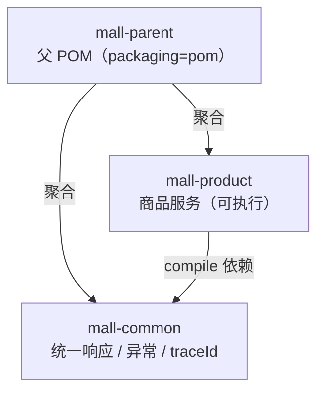
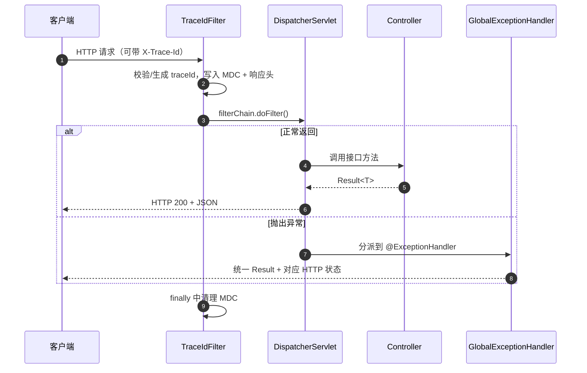

# Day 1 技术设计文档 —— 工程骨架与通用基础设施

| 项 | 内容 |
|---|---|
| 文档版本 | v1.0 |
| 对应代码 | `mall` 仓库 `main` 分支，提交 `ae608d0` |
| 适用阶段 | Day 1（工程骨架） |
| 编写时间 | 2026-10-25 |
| 读者对象 | 后端开发、后续参与本项目的同学 |

---

## 1. 概述

### 1.1 项目背景

本项目是一个按「单体跑通交易闭环 → 工程化 → 缓存 → 异步 → 微服务 → 分库分表」路线逐步演进
的 Java 电商平台。整体目标见 [README](../README.md)。

### 1.2 Day 1 目标

Day 1 **不写任何业务逻辑**，只做两件事：

1. **搭好可长期演进的工程骨架**：父 POM、多模块、依赖版本统一管理。
2. **沉淀所有模块都要用的通用能力**：统一响应、错误码、全局异常、链路追踪、日志规范。

> 判断标准：后面新增 `mall-order`、`mall-user` 等模块时，只需要在 `pom.xml` 里加一行
> `mall-common` 依赖，统一响应 / 异常 / traceId 就自动生效，不需要复制任何代码。

### 1.3 Day 1 范围

| 包含 | 不包含（后续阶段） |
|---|---|
| 父 POM 与模块聚合 | 数据库表结构与 Flyway（Day 2） |
| 统一响应 `Result` | MyBatis-Plus 与商品接口（Day 2） |
| 错误码体系 `ResultCode` | 用户注册登录（Day 3） |
| 业务异常 `BizException` | 下单/支付闭环（Week 2） |
| 全局异常处理 | Redis 缓存（M3） |
| traceId 链路追踪 | 消息队列（M4） |
| 日志与监控配置 | 微服务拆分（M5） |
| 本地基础设施（MySQL/Redis） | 分库分表（M7） |

---

## 2. 技术选型

| 分类 | 选型 | 版本 | 选型理由 |
|---|---|---|---|
| JDK | OpenJDK | 21 (LTS) | 是当前 LTS，支持虚拟线程（后续可试），生态成熟 |
| 构建 | Maven 多模块 | 3.9.9 | 结构直观，团队上手成本低；多模块便于后续拆服务 |
| 框架 | Spring Boot | 3.3.5 | 3.3.x 稳定版，与 Spring Cloud 2023.0.x 对齐 |
| Spring Framework | — | 6.1.14 | 随 Boot 3.3.5 引入 |
| Web | Spring MVC + 内嵌 Tomcat | — | 电商以同步业务为主，MVC 足够；后续网关用 WebFlux |
| 校验 | Jakarta Validation | — | 标准注解，配合全局异常统一输出 |
| 日志 | Logback | 1.5.11 | Boot 默认，配合 MDC 输出 traceId |
| 数据库 | MySQL | 8.0.36 | 生态与运维成熟，8.0 支持窗口函数等特性 |
| 缓存 | Redis | 7.2 | 后续做多级缓存与库存预扣 |
| 容器 | Docker Compose | — | 一键拉起本地中间件，避免「我这能跑」 |

> **版本纪律**：Spring Boot / Spring Cloud / Spring Cloud Alibaba 必须成套使用。
> 本项目 M5 阶段将使用 Spring Cloud `2023.0.3` + Spring Cloud Alibaba `2023.0.3.2`，
> 与 Boot 3.3.x 对齐，父 POM 中已预留（注释状态）。

---

## 3. 工程结构

### 3.1 模块划分

```
mall/
├── pom.xml                     # 父 POM：版本管理、模块聚合
├── mall-common/                # 通用层（被所有业务模块依赖）
├── mall-product/               # 商品服务（第一个业务模块 / 当前唯一可启动应用）
├── docker-compose.yml          # 本地基础设施
├── docs/                       # 文档
└── .github/ (未启用)           # 后续放 CI
```

### 3.2 依赖关系



**关键约束：**

- `mall-common` 只允许放与业务无关的通用能力，**不允许**依赖任何业务模块。
- 业务模块之间**不允许**互相依赖（后续拆微服务时改为 RPC 调用）。
- 只有业务模块才配置 `spring-boot-maven-plugin`，`mall-common` 不打可执行包。

### 3.3 包结构约定

```
com.mall.<module>
├── controller/     # 只做参数接收与结果返回，不写业务逻辑
├── service/        # 业务逻辑（Day 2 起）
│   └── impl/
├── mapper/         # 数据访问（Day 2 起）
├── entity/         # 数据库实体
├── dto/            # 入参对象
├── vo/             # 出参对象
├── convert/        # 对象转换（entity <-> dto/vo）
└── config/         # 模块级配置
```

`mall-common` 的包结构：

```
com.mall.common
├── api/            # Result、ResultCode、PageResult
├── exception/      # BizException、GlobalExceptionHandler
├── web/            # TraceIdFilter、TraceContext、CommonWebAutoConfiguration
└── util/           # IdUtils
```

---

## 4. 架构设计

### 4.1 请求处理链路



### 4.2 通用能力的注入方式（重要设计）

业务模块的包扫描根是 `com.mall.product`，而 `mall-common` 的类在 `com.mall.common` 下，
默认**扫不到**。本项目没有使用 `@ComponentScan(basePackages = "com.mall")`
（这种方式会把通用层和业务层耦合在一起，且容易误扫），而是采用 Spring Boot 标准做法：
**自动装配**。

实现三要素：

1. 自动装配类：`com.mall.common.web.CommonWebAutoConfiguration`

```java
@AutoConfiguration
@ConditionalOnWebApplication(type = ConditionalOnWebApplication.Type.SERVLET)
public class CommonWebAutoConfiguration {

    @Bean
    @ConditionalOnMissingBean
    public TraceIdFilter traceIdFilter() { ... }

    @Bean
    @ConditionalOnMissingBean
    public GlobalExceptionHandler globalExceptionHandler() { ... }
}
```

2. 注册文件（固定路径，Boot 3 规范）：
   `mall-common/src/main/resources/META-INF/spring/org.springframework.boot.autoconfigure.AutoConfiguration.imports`

```
com.mall.common.web.CommonWebAutoConfiguration
```

3. 业务模块引入依赖即可，**零配置**：

```xml
<dependency>
    <groupId>com.mall</groupId>
    <artifactId>mall-common</artifactId>
</dependency>
```

**设计收益：**

- 新增业务模块时通用能力自动生效，不会出现「这个模块忘了加异常处理」。
- 使用 `@ConditionalOnMissingBean`，业务方可以自定义覆盖（例如替换自己的 traceId 过滤器）。
- 通用层可以被独立测试，也可以被其他非本项目工程复用。

### 4.3 设计决策记录（ADR）

#### ADR-001：先做单体多模块，不直接上微服务

- **背景**：目标是百万流量架构，但当前从 0 开始。
- **决策**：M1~M4 阶段保持单体多模块，M5 再按依赖顺序拆分。
- **理由**：微服务的分布式事务、链路排查、服务治理成本很高；业务还没验证就跑微服务，
  会让 80% 的时间花在基础设施而不是业务上。模块化单体在需要时可按模块边界拆出服务。
- **代价**：模块间调用是本地方法调用，未来拆分时需要把接口抽到 `mall-api`。

#### ADR-002：业务失败返回 HTTP 200 + 业务码

- **决策**：`BizException` → HTTP 200，`code` 为业务错误码。
- **理由**：
  - 业务失败（库存不足、重复提交）不是协议层的错误，用 4xx/5xx 会污染监控指标，
    导致错误率告警失真。
  - 前端只需统一判断 `code`，不必维护「哪些 HTTP 状态码算业务失败」的映射。
- **例外**：参数校验 400、鉴权 401、资源不存在 404、系统异常 500 仍使用标准状态码，
  便于网关、负载均衡、监控系统正确识别。

#### ADR-003：自研轻量 traceId，而不是 Day 1 就接 SkyWalking

- **决策**：`TraceIdFilter` + MDC 实现最基础的链路标识。
- **理由**：Day 1 只有一个服务，接入 APM 的收益低；traceId 先统一到请求头与日志里，
  后续接 SkyWalking 时可以直接复用同一个 `X-Trace-Id` 头与日志格式，迁移成本几乎为零。
- **代价**：跨服务调用时 traceId 需要手动透传（已在 `TraceContext` 提供包装方法，
  M5 会通过 Feign 拦截器自动透传）。

---

## 5. 核心能力设计

### 5.1 统一响应 `Result<T>`

**字段定义**

| 字段 | 类型 | 说明 |
|---|---|---|
| `code` | int | 业务状态码，0 表示成功 |
| `message` | String | 提示信息，可直接展示给用户 |
| `data` | T | 业务数据，失败时为 null |
| `traceId` | String | 链路追踪 ID，自动从 MDC 获取 |
| `timestamp` | long | 服务器时间戳（毫秒） |
| `success` | boolean | 由 `isSuccess()` 序列化生成，等价于 `code == 0` |

**响应示例（实测）**

```json
{
  "code": 0,
  "message": "成功",
  "data": {
    "service": "mall-product",
    "status": "UP",
    "serverTime": "2026-10-25T22:41:29.473979800+08:00",
    "javaVersion": "21.0.12",
    "profile": "dev"
  },
  "traceId": "1a173826b80_599bb65d6227e210",
  "timestamp": 1792939289473,
  "success": true
}
```

**API 一览**

| 方法 | 用途 |
|---|---|
| `Result.ok()` | 成功，无数据（删除、状态变更类接口） |
| `Result.ok(data)` | 成功，带数据 |
| `Result.fail(ResultCode)` | 失败，使用枚举默认文案 |
| `Result.fail(ResultCode, message)` | 失败，自定义文案（如「库存仅剩 2 件」） |
| `Result.fail(code, message)` | 失败，直接指定错误码（不推荐业务直接调用） |
| `isSuccess()` | 判断是否成功，同时驱动 `success` 字段序列化 |

> 构造 `Result` 时会自动抓取当前线程 MDC 中的 traceId 与服务器时间，
> 业务代码不需要手动设置。

**分页结构 `PageResult<T>`**

| 字段 | 说明 |
|---|---|
| `records` | 当前页数据，**永不为 null**（无数据时为空集合） |
| `total` | 总记录数 |
| `pageNum` / `pageSize` | 当前页码（从 1 开始）/ 每页条数 |
| `pages` | 总页数，由 `ceil(total / pageSize)` 自动计算 |

---

### 5.2 错误码规范 `ResultCode`

**编码规则**：按业务段划分区间，同段内编码连续并预留空号。

| 区间 | 归属 | 示例 |
|---|---|---|
| `0` | 成功 | `SUCCESS(0)` |
| `10xxx` | 通用/框架层 | `PARAM_ERROR(10000)`、`NOT_FOUND(10004)`、`REQUEST_TOO_FREQUENT(10029)` |
| `11xxx` | 用户 | `USER_NOT_FOUND(11001)`、`PASSWORD_ERROR(11003)` |
| `20xxx` | 商品 | `PRODUCT_NOT_FOUND(20001)`、`PRODUCT_OFF_SHELF(20002)` |
| `25xxx` | 购物车 | `CART_ITEM_NOT_FOUND(25001)` |
| `30xxx` | 订单 | `ORDER_NOT_FOUND(30001)`、`ORDER_STATUS_ILLEGAL(30002)` |
| `40xxx` | 库存 | `STOCK_NOT_ENOUGH(40001)`、`STOCK_DEDUCT_FAILED(40002)` |
| `50xxx` | 支付 | `PAYMENT_NOT_FOUND(50001)`、`PAYMENT_ALREADY_PAID(50002)` |
| `99999` | 系统兜底 | `SYSTEM_ERROR(99999)` |

**使用规则：**

1. 新增错误码必须落在对应业务段内，**不允许随意改已有编码**（前端会硬编码判断）。
2. `ResultCode.fromCode(int)` 查不到时返回 `SYSTEM_ERROR`，**永不返回 null**。
3. 面向用户的文案放在 `message` 里，技术细节只进日志。

**完整错误码表**

| 码 | 枚举 | 文案 | 使用场景 |
|---|---|---|---|
| 0 | SUCCESS | 成功 | 业务成功 |
| 10000 | PARAM_ERROR | 参数错误 | 缺参、类型不匹配、`@Valid` 失败 |
| 10001 | UNAUTHORIZED | 未登录或登录已过期 | token 缺失/失效 |
| 10003 | FORBIDDEN | 无访问权限 | 越权访问 |
| 10004 | NOT_FOUND | 资源不存在 | 路径不存在、数据不存在 |
| 10005 | METHOD_NOT_ALLOWED | 请求方法不支持 | 方法不匹配 |
| 10006 | MEDIA_TYPE_NOT_SUPPORTED | 请求格式不支持 | Content-Type 不支持 |
| 10029 | REQUEST_TOO_FREQUENT | 请求过于频繁，请稍后再试 | 限流/风控 |
| 11001 | USER_NOT_FOUND | 用户不存在 | 用户查询 |
| 11002 | USERNAME_EXISTS | 用户名已存在 | 注册 |
| 11003 | PASSWORD_ERROR | 用户名或密码错误 | 登录 |
| 20001 | PRODUCT_NOT_FOUND | 商品不存在 | 商品详情 |
| 20002 | PRODUCT_OFF_SHELF | 商品已下架 | 加购/下单校验 |
| 20003 | SKU_NOT_FOUND | SKU 不存在 | SKU 查询 |
| 25001 | CART_ITEM_NOT_FOUND | 购物车中不存在该商品 | 修改/删除购物车 |
| 30001 | ORDER_NOT_FOUND | 订单不存在 | 订单详情 |
| 30002 | ORDER_STATUS_ILLEGAL | 当前订单状态不允许该操作 | 状态机校验 |
| 30003 | ORDER_AMOUNT_MISMATCH | 订单金额校验失败 | 下单金额重算 |
| 30004 | ORDER_REPEAT_SUBMIT | 请勿重复提交 | 幂等控制 |
| 40001 | STOCK_NOT_ENOUGH | 库存不足 | 库存扣减 |
| 40002 | STOCK_DEDUCT_FAILED | 库存扣减失败 | 并发扣减失败 |
| 50001 | PAYMENT_NOT_FOUND | 支付单不存在 | 支付查询 |
| 50002 | PAYMENT_ALREADY_PAID | 订单已支付，请勿重复操作 | 重复支付 |
| 99999 | SYSTEM_ERROR | 系统繁忙，请稍后再试 | 未预期异常 |

---

### 5.3 全局异常处理

**处理矩阵**

| 异常类型 | HTTP | code | 日志级别 | 是否返回堆栈 |
|---|---|---|---|---|
| `BizException` | 200 | 异常自带 | WARN | 否 |
| `MethodArgumentNotValidException`（`@RequestBody @Valid`） | 400 | 10000 | WARN | 否 |
| `ConstraintViolationException`（`@Validated` 方法参数） | 400 | 10000 | WARN | 否 |
| `MissingServletRequestParameterException` | 400 | 10000 | WARN | 否 |
| `HttpMessageNotReadableException` | 400 | 10000 | WARN | 否 |
| `NoResourceFoundException` / `NoHandlerFoundException` | 404 | 10004 | WARN | 否 |
| `HttpRequestMethodNotSupportedException` | 405 | 10005 | WARN | 否 |
| `HttpMediaTypeNotSupportedException` | 415 | 10006 | WARN | 否 |
| 其他 `Exception` | 500 | 99999 | ERROR | 否（只进日志） |

**实现要点**

1. 继承 `ResponseEntityExceptionHandler`，Spring MVC 内置的十几种异常
   只需重写 `handleExceptionInternal` 即可统一包装，**不用逐个写 handler**。
2. `BizException` 重写了 `fillInStackTrace()` 返回自身——业务异常是正常流程的一部分，
   高频抛出时不抓堆栈可以省下可观的 CPU。
3. 未知异常只返回「系统繁忙」，堆栈写入日志并带 traceId，用户报障时凭 traceId 定位。

**代码骨架**

```java
@ExceptionHandler(BizException.class)
public ResponseEntity<Result<Void>> handleBizException(BizException ex) {
    log.warn("业务异常 | code={} | message={}", ex.getCode(), ex.getMessage());
    return ResponseEntity.ok(Result.fail(ex.getCode(), ex.getMessage()));
}

@ExceptionHandler(Exception.class)
public ResponseEntity<Result<Void>> handleUncaught(Exception ex) {
    log.error("系统异常 | type={}", ex.getClass().getName(), ex);
    return ResponseEntity.internalServerError().body(Result.fail(ResultCode.SYSTEM_ERROR));
}
```

---

### 5.4 链路追踪 `traceId`

**生成规则**

- 优先继承请求头 `X-Trace-Id`（网关、前端、APM 传入），保证全链路一致。
- 未传或格式非法时生成：`Long.toHexString(当前毫秒时间戳) + "_" + Long.toHexString(随机数)`，
  例：`1a173826b80_599bb65d6227e210`。时间戳前缀便于按时间排序。
- 合法性校验：长度 8~64，字符集 `[0-9a-zA-Z_-]`，防止上游传入超长或恶意内容。

**传递路径**

| 位置 | 说明 |
|---|---|
| MDC（`traceId`） | 日志模板 `%X{traceId}` 直接输出 |
| 响应头 `X-Trace-Id` | 前端/调用方可记录，报障时回传 |
| 响应体 `Result.traceId` | 业务侧可直接拿到 |

**生命周期**

```java
try {
    filterChain.doFilter(request, response);
} finally {
    TraceContext.clear();   // 必须清理，防止 Tomcat 线程池复用导致串号
}
```

**异步场景**

MDC 基于 ThreadLocal，线程池中会丢失。`TraceContext` 提供包装方法：

```java
executor.submit(TraceContext.wrap(() -> doSomething()));           // Runnable
executor.submit(TraceContext.wrapCallable(() -> queryData()));     // Callable
```

> M5 引入 Feign/消息队列后，会在此基础上增加拦截器自动透传。

---

### 5.5 日志规范

**配置**：`mall-product/src/main/resources/logback-spring.xml`

| 项 | 值 |
|---|---|
| 日志目录 | `${LOG_PATH:-./logs}` |
| 应用日志 | `logs/mall-product.log` |
| 错误日志 | `logs/mall-product-error.log`（只收 ERROR） |
| 滚动策略 | 按天 + 单文件 100MB |
| 保留 | 最长 15 天，总量上限 3GB |
| 输出格式 | `时间 级别 [线程] [traceId] 类名 - 消息` |

**格式示例（实测）**

```
2026-10-25 22:41:35.355 WARN  [http-nio-8081-exec-9] [1a173828277_3f137727b7802e95] c.m.c.exception.GlobalExceptionHandler - 请求异常 | status=404 | type=NoResourceFoundException | message=接口不存在: /not-exist
```

**规范约定：**

1. 业务关键节点打 INFO，异常打 ERROR/WARN，禁止 `e.printStackTrace()`。
2. 日志中带业务主键（订单号、商品 ID），便于与 traceId 交叉检索。
3. 禁止打印密码、token、完整手机号等敏感信息。
4. 生产环境把 `LOG_PATH` 指向挂载卷，由日志采集组件统一收集。

---

## 6. 接口文档

> Day 1 只有自检接口，用于验证骨架是否正常工作；Day 2 起替换为真实业务接口。

### 6.1 连通性检查

`GET /ping`

**响应（实测）**

```json
{
  "code": 0,
  "message": "成功",
  "data": {
    "service": "mall-product",
    "status": "UP",
    "serverTime": "2026-10-25T22:41:29.473979800+08:00",
    "javaVersion": "21.0.12",
    "profile": "dev"
  },
  "traceId": "1a173826b80_599bb65d6227e210",
  "timestamp": 1792939289473,
  "success": true
}
```

### 6.2 业务异常验证

`GET /ping/biz-error` —— 验证「业务失败返回 200 + 业务码」

```json
{"code":40001,"message":"商品库存不足，当前可售 0 件","data":null,
 "traceId":"1a17382822c_c0a143fd1c77bdd","timestamp":1792939295278,"success":false}
```

### 6.3 参数校验验证

`GET /ping/validate?name=` —— 验证 400 + 10000

```json
{"code":10000,"message":"validate.name 不能为空","data":null,
 "traceId":"1a173828242_e44c96c0262840e4","timestamp":1792939295311,"success":false}
```

### 6.4 未知异常验证

`GET /ping/boom` —— 验证 500 + 99999 且不泄露堆栈

```json
{"code":99999,"message":"系统繁忙，请稍后再试","data":null,
 "traceId":"1a173828262_1323fafadb10f2d0","timestamp":1792939295334,"success":false}
```

### 6.5 健康检查

`GET /actuator/health`

```json
{"status":"UP","components":{
  "diskSpace":{"status":"UP","details":{"total":322121494528,"free":127681208320,"threshold":10485760,"path":"E:\\deepseek\\mall\\.","exists":true}},
  "ping":{"status":"UP"}}}
```

---

## 7. 配置说明

### 7.1 主配置 `application.yml`

| 配置 | 值 | 说明 |
|---|---|---|
| `server.port` | 8081 | 商品服务端口 |
| `server.shutdown` | graceful | 优雅停机 |
| `spring.lifecycle.timeout-per-shutdown-phase` | 30s | 存量请求最长等待 |
| `server.tomcat.threads.max` | 200 | 工作线程数，后续按压测调整 |
| `server.tomcat.accept-count` | 200 | 等待队列，超出直接拒绝 |
| `server.tomcat.connection-timeout` | 5s | 连接超时 |
| `spring.jackson.time-zone` | Asia/Shanghai | 避免时区偏差 |
| `spring.jackson.date-format` | `yyyy-MM-dd HH:mm:ss` | 统一时间格式 |
| `management.endpoints.web.exposure.include` | health,info,metrics | 生产不要开 `*` |
| `spring.profiles.active` | dev | 生产用命令行覆盖 |

### 7.2 环境配置 `application-dev.yml`

- 日志级别：`com.mall` 调为 DEBUG。
- 数据库/Redis 配置**已预置但注释**，Day 2 接入时取消注释即可，避免现在启动时因缺依赖报错。

### 7.3 配置优先级

```
命令行参数 > 环境变量 > application-{profile}.yml > application.yml
```

**约定**：密码等敏感信息一律走环境变量（`MYSQL_ROOT_PASSWORD`、`REDIS_PASSWORD`），不进 Git。

---

## 8. 本地开发环境

### 8.1 基础设施

`docker-compose.yml` 提供：

| 服务 | 镜像 | 端口 | 账号/密码 | 健康检查 |
|---|---|---|---|---|
| MySQL | mysql:8.0.36 | 3306 | `root` / `mall123456`，库 `mall` | `mysqladmin ping` |
| Redis | redis:7.2-alpine | 6379 | 密码 `mall123456` | `redis-cli ping` |

配置项：`utf8mb4` 字符集、`Asia/Shanghai` 时区、`innodb_buffer_pool_size=512M`、最大连接 1000。

**端口冲突处理**：复制 `.env.example` 为 `.env`，修改 `MYSQL_PORT` / `REDIS_PORT`。

### 8.2 环境变量

| 变量 | 默认值 | 用途 |
|---|---|---|
| `MYSQL_ROOT_PASSWORD` | mall123456 | MySQL root 密码 |
| `REDIS_PASSWORD` | mall123456 | Redis 密码 |
| `MYSQL_PORT` / `REDIS_PORT` | 3306 / 6379 | 宿主机映射端口 |
| `LOG_PATH` | ./logs | 日志输出目录 |

---

## 9. 构建与运行

### 9.1 环境要求

| 项 | 要求 |
|---|---|
| JDK | 21（**必须是 21**，项目用 `--release 21` 编译） |
| Maven | 3.8+ |
| Docker | Docker Desktop（Windows 需 WSL2） |

### 9.2 命令

```bash
# 1. 启动基础设施
docker compose up -d

# 2. 编译 + 测试（先 install，业务模块才能解析 mall-common）
mvn clean install

# 3. 启动应用
mvn -pl mall-product -am spring-boot:run
# 或
java -jar mall-product/target/mall-product.jar

# 4. 验证
curl.exe http://localhost:8081/ping
```

### 9.3 常见问题

| 现象 | 原因 | 处理 |
|---|---|---|
| `invalid target release: 21` | Maven 用了 JDK 8 | 设置 `JAVA_HOME` 指向 JDK 21，`mvn -v` 确认 |
| 找不到 `com.mall:mall-common` | 未先 `install` | 先执行 `mvn clean install` |
| `Port 8081 was already in use` | 端口占用 | `netstat -ano \| findstr 8081` 找到并结束 |
| 控制台中文乱码 | PowerShell 代码页 936 | 执行 `chcp 65001`；文件日志本身是 UTF-8 |
| git push 连接被重置 | 直连 GitHub 被墙 | 走代理：`git -c http.proxy=http://127.0.0.1:7897 push` |

> **本机现状**：JDK 21 位于 `C:\Program Files\Java\jdk-21.0.12`，
> 但系统 `JAVA_HOME` 仍指向 JDK 8，需手动切换（见 README 常见问题第 4 条）。

---

## 10. 测试与验收

### 10.1 单元测试

`PingControllerTest`（`@SpringBootTest` + `@AutoConfigureMockMvc`）

| 用例 | 验证点 |
|---|---|
| `pingShouldReturnUnifiedResult` | 统一结构、`code=0`、`data.service`、响应头存在 `X-Trace-Id` |
| `traceIdShouldBePropagated` | 上游 `X-Trace-Id` 原样透传（响应头 + 响应体） |
| `bizExceptionShouldReturnBusinessCode` | `BizException` → HTTP 200 + 40001 |
| `validationShouldReturn400` | 参数校验 → HTTP 400 + 10000 |
| `uncaughtExceptionShouldReturn500` | 未知异常 → HTTP 500 + 99999 |

**执行结果**

```
Tests run: 5, Failures: 0, Errors: 0, Skipped: 0
BUILD SUCCESS
```

### 10.2 启动验证（实测）

| 项 | 结果 |
|---|---|
| 构建 | `BUILD SUCCESS`，`javac [debug parameters release 21]` |
| 启动耗时 | 2.219 秒 |
| 端口 | 8081（Tomcat） |
| 进程 | Spring Boot 3.3.5 / JDK 21.0.12 |

### 10.3 接口验收（实测）

| # | 请求 | HTTP | code | 结果 |
|---|---|---|---|---|
| 1 | `GET /ping` | 200 | 0 | 通过 |
| 2 | `GET /ping` + `X-Trace-Id: trace-12345678` | 200 | 0 | traceId 透传一致 |
| 3 | `GET /ping/biz-error` | 200 | 40001 | 通过 |
| 4 | `GET /ping/validate?name=` | 400 | 10000 | 通过 |
| 5 | `GET /ping/boom` | 500 | 99999 | 通过，无堆栈外泄 |
| 6 | `GET /not-exist` | 404 | 10004 | 通过，提示「接口不存在: /not-exist」 |
| 7 | `GET /actuator/health` | 200 | — | `{"status":"UP"}` |

### 10.4 日志验收

- 每行包含 `[traceId]`，同一次请求可按 traceId 串联。
- 中文输出正常（UTF-8）。
- 500 异常堆栈只写入文件，不返回给客户端。

---

## 11. 已知限制

| 限制 | 影响 | 计划 |
|---|---|---|
| 未接数据库 | 无法持久化 | Day 2：Flyway + MyBatis-Plus |
| 未接 Redis | 无缓存能力 | Day 2~3 |
| 无鉴权 | 接口裸奔 | Day 3：JWT |
| 无网关 | 无限流/路由 | M5 |
| traceId 不跨服务 | 单服务内可追踪 | M5：Feign/MQ 拦截器 |
| 无 CI | 靠本地构建 | M2：GitHub Actions |
| 未做压测 | 容量未知 | M3 起建立基线 |

---

## 12. 后续演进

| 阶段 | 内容 | 状态 |
|---|---|---|
| Day 1 | 工程骨架 + 通用基础设施 | 已完成 |
| Day 2 | 商品域四张表 + Flyway + MyBatis-Plus + 商品列表/详情 | 待开始 |
| Day 3 | 用户注册登录（JWT）+ 购物车 | 计划中 |
| M2 | 工程化：单元测试规范、CI、代码规范检查 | 计划中 |
| M3 | Redis 多级缓存 + 压测基线 | 计划中 |
| M4 | RocketMQ 异步化 + 本地消息表 + 幂等 | 计划中 |
| M5 | 微服务拆分（Nacos/Gateway/Sentinel/SkyWalking） | 计划中 |
| M6 | 秒杀专项：Redis Lua 扣减 + 库存分桶 | 计划中 |
| M7 | 分库分表（ShardingSphere）+ ES 搜索 | 计划中 |
| M8 | 可观测 + K8s 部署 + 全链路压测 | 计划中 |

---

## 13. 附录

### 13.1 目录树

```
mall/
├── .env.example
├── .gitattributes
├── .gitignore
├── README.md
├── docker-compose.yml
├── pom.xml
├── docs/
│   ├── day1.md                       # Day 1 验收清单
│   └── day1-tech-design.md           # 本文档
├── mall-common/
│   ├── pom.xml
│   └── src/main/
│       ├── java/com/mall/common/
│       │   ├── api/{Result,ResultCode,PageResult}.java
│       │   ├── exception/{BizException,GlobalExceptionHandler}.java
│       │   ├── util/IdUtils.java
│       │   └── web/{TraceContext,TraceIdFilter,CommonWebAutoConfiguration}.java
│       └── resources/META-INF/spring/
│           └── org.springframework.boot.autoconfigure.AutoConfiguration.imports
└── mall-product/
    ├── pom.xml
    └── src/
        ├── main/java/com/mall/product/
        │   ├── ProductApplication.java
        │   ├── controller/PingController.java
        │   └── vo/PingVO.java
        ├── main/resources/{application.yml,application-dev.yml,logback-spring.xml}
        └── test/java/com/mall/product/controller/PingControllerTest.java
```

### 13.2 变更记录

| 提交 | 内容 |
|---|---|
| `8a8c21e` | chore: 初始化工程骨架（Day 1） |
| `ee26f50` | fix: 404 提示补全路径前缀；docs: 补充 JDK 21 环境说明 |
| `ae608d0` | docs: 为通用模块、配置文件与 POM 补充中文注释 |
| 本文档 | docs: Day 1 技术设计文档 |

### 13.3 参考

- [Spring Boot 3.3 官方文档](https://docs.spring.io/spring-boot/3.3/)
- [Spring Framework 6.1 异常处理](https://docs.spring.io/spring-framework/reference/web/webmvc/mvc-servlet/exceptionhandlers.html)
- [Logback MDC 手册](https://logback.qos.ch/manual/mdc.html)
- 项目 [README](../README.md)、[Day 1 验收清单](day1.md)
