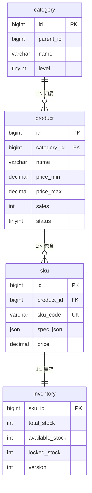
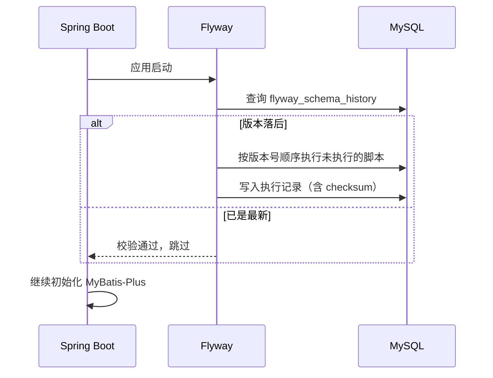

# Day 2 技术设计文档 —— 商品域数据模型与查询接口

| 项 | 内容 |
|---|---|
| 文档版本 | v1.0 |
| 对应代码 | `mall` 仓库 `main` 分支（Day 2 相关提交见文末变更记录） |
| 适用阶段 | Day 2（商品域落地） |
| 编写时间 | 2026-10-27 |
| 前置阅读 | [Day 1 技术设计文档](day1-tech-design.md) |

---

## 1. 概述

### 1.1 目标

Day 1 只有骨架，应用连不上数据库。Day 2 要把「应用 → MySQL」这条链路真正打通，并交付第一个
有业务价值的模块：**商品浏览**。

具体四件事：

1. 设计商品域四张表（`category` / `product` / `sku` / `inventory`）
2. 用 Flyway 做数据库版本管理，启动自动建表
3. 接入 MyBatis-Plus，实现分页插件与防全表更新
4. 交付商品列表（分页 + 筛选）与商品详情（含 SKU 与库存）两个接口

### 1.2 不包含

| 不包含 | 原因 / 计划 |
|---|---|
| 商品增删改（后台管理） | Day 3 之后 |
| Redis 缓存 | M3 阶段，先保证 SQL 与索引正确 |
| 下单、库存扣减 | Week 2 |
| 商品搜索（分词/聚合） | M7 接入 ES |
| 图片上传 | 依赖对象存储，暂用占位 URL |

### 1.3 交付物

| 类型 | 内容 |
|---|---|
| 数据库脚本 | `V1__create_product_tables.sql`、`V2__seed_product_data.sql` |
| 实体 / Mapper | `Product`、`Sku`、`Category`、`Inventory` + 4 个 Mapper |
| 服务层 | `ProductService` / `ProductServiceImpl` |
| 接口层 | `ProductController`（2 个 GET 接口） |
| 配置 | MyBatis-Plus、Flyway、数据源（3307） |
| 测试 | 12 个集成测试用例（5 Ping + 7 Product） |

---

## 2. 数据模型设计

### 2.1 ER 关系



### 2.2 表清单

| 表 | 职责 | 预估量级 | 分片键（M7 规划） |
|---|---|---|---|
| `category` | 类目树（邻接表） | 百级 | 不分片，全量缓存 |
| `product` | 商品共性信息（SPU） | 百万级 | 按 `category_id` / 哈希 |
| `sku` | 可售单元 | 千万级 | 随 `product_id` |
| `inventory` | 库存 | 千万级 | 随 `sku_id`，独立热点 |

### 2.3 关键设计决策

#### 决策 1：SPU + SKU 两层模型

- **SPU（product）**：描述「这是什么」。iPhone 15 Pro 是一个 SPU。
- **SKU（sku）**：描述「具体买哪一款」。128GB 黑色是一个 SKU，有自己的价格和库存。

**理由**：电商必须支持同一商品多规格、多价格、独立库存。如果把规格塞进 product 的一行 JSON，
库存与价格就无法精确到规格，下单会扣错。

#### 决策 2：库存独立成表，不放在 sku 上

**理由**：

1. 库存是**高频写**（每次下单都改），商品信息是**低频写**（运营改标题），拆开后互不干扰。
2. 后续要做「Redis 预扣 + 数据库乐观锁兜底 + 库存分桶」，库存需要独立的 `version` 字段与
   独立的扩缩容策略。
3. 商品表可以整体缓存/加只读副本，库存表不行。

**数量约束**：`available_stock = total_stock - locked_stock`，表上有 `CHECK` 约束保证非负。

#### 决策 3：规格用 JSON 列

```json
[{"name":"容量","value":"128GB"},{"name":"颜色","value":"黑色"}]
```

**理由**：不同类目的规格维度完全不同（手机看容量，衣服看尺码），用固定列会建出几十个空字段，
用 EAV 表又会让查询复杂。JSON 列在 MySQL 8 上可校验、可部分索引。

**代价**：不能直接对 JSON 内部字段建普通索引。若后续要「按颜色筛选」，方案是
→ 生成列（generated column）+ 索引，或同步到 ES。当前不需要。

#### 决策 4：主键用雪花算法（BIGINT）

- 不用自增：分库分表后自增会冲突。
- 不用 UUID：字符串主键占空间、索引效率低、无序导致页分裂。

MyBatis-Plus 的 `ASSIGN_ID` 即雪花算法（`IdType.ASSIGN_ID`），后续分片无需改 ID 方案。

#### 决策 5：金额用 DECIMAL(10,2)

`float/double` 有二进制精度误差，`0.1 + 0.2 != 0.3`，金额计算会出现 1 分钱对不上。
统一 `DECIMAL(10,2)`，Java 侧用 `BigDecimal`。

### 2.4 索引设计

| 表 | 索引 | 支撑的查询 |
|---|---|---|
| `product` | `idx_status_sales (status, sales DESC)` | 列表「上架商品按销量降序」——最核心的查询 |
| `product` | `idx_category_id (category_id)` | 按类目筛选 |
| `product` | `idx_name (name)` | 名称前缀匹配（`like 'x%'` 可用；`%x%` 不走索引，见下方限制） |
| `sku` | `uk_sku_code (sku_code)` | 业务唯一，防重复编码 |
| `sku` | `idx_product_id (product_id)` | 详情页按商品查 SKU |
| `inventory` | 主键 `sku_id` | 按 SKU 查/改库存 |
| `category` | `idx_parent_id` | 查询子类目 |

**已知限制**：列表的 `keyword` 用 `like '%关键字%'`，无法走 `idx_name`，数据量大时会全表扫描。
这是搜索场景的固有问题，M7 会用 ES 解决，当前数据量下可接受。

---

## 3. 数据库版本管理（Flyway）

### 3.1 目录与命名

```
mall-product/src/main/resources/db/migration/
├── V1__create_product_tables.sql    # 建表
└── V2__seed_product_data.sql        # 种子数据
```

命名规则：`V{版本号}__{描述}.sql`（两个下划线）。版本号只增不减。

### 3.2 启动流程



### 3.3 配置

```yaml
spring:
  flyway:
    enabled: true
    locations: classpath:db/migration
    baseline-on-migrate: true   # 已有表但没有历史表时，先打基线
    validate-on-migrate: true   # 校验已执行脚本是否被篡改
    encoding: UTF-8
```

### 3.4 团队约定（重要）

1. **已执行的脚本禁止修改**。Flyway 会校验 checksum，改了会导致启动失败。
   需要改表结构就新增 `V3__...sql`。
2. 生产环境用 `flyway:migrate` 单独执行，不要依赖应用启动（避免多实例并发迁移）。
3. 大表加字段/加索引在 MySQL 8 用 `ALGORITHM=INPLACE`，并避开业务高峰。
4. 种子数据（V2）仅用于开发环境；生产通过管理后台或初始化脚本导入。

---

## 4. 数据访问层

### 4.1 依赖与版本坑

| 依赖 | 版本 | 说明 |
|---|---|---|
| `mybatis-plus-spring-boot3-starter` | 3.5.9 | Boot 3 专用 starter |
| `mybatis-plus-jsqlparser` | 3.5.9 | **必须显式引入** |
| `mysql-connector-j` | Boot 托管 | 驱动 |
| `flyway-core` / `flyway-mysql` | 10.10.0（Boot 托管） | Flyway 10 起 MySQL 支持独立成模块 |

> **踩坑记录**：MyBatis-Plus 从 3.5.9 开始把 JSqlParser 拆出默认依赖，
> 分页插件 `PaginationInnerInterceptor` 与 `BlockAttackInnerInterceptor`
> 都在 `mybatis-plus-jsqlparser` 里。只引 starter 会编译报「找不到符号」。

### 4.2 配置类

```java
@Configuration
@MapperScan("com.mall.product.mapper")
public class MybatisPlusConfig {

    @Bean
    public MybatisPlusInterceptor mybatisPlusInterceptor() {
        MybatisPlusInterceptor interceptor = new MybatisPlusInterceptor();

        PaginationInnerInterceptor pagination = new PaginationInnerInterceptor(DbType.MYSQL);
        pagination.setMaxLimit(100L);     // 防止 pageSize=100000 打挂数据库
        pagination.setOverflow(false);    // 页码越界返回空，不回第一页
        interceptor.addInnerInterceptor(pagination);

        interceptor.addInnerInterceptor(new BlockAttackInnerInterceptor()); // 拦截无 where 的 update/delete
        return interceptor;
    }
}
```

**为什么必须有分页插件**：不配 `PaginationInnerInterceptor` 时，`selectPage` 会退化为
「查全表再内存截取」，数据量一大就是灾难。

### 4.3 映射约定

| 数据库 | Java | 说明 |
|---|---|---|
| `available_stock` | `availableStock` | `map-underscore-to-camel-case: true` |
| `spec_json` (JSON) | `String specJson` | 由 Service 层用 Jackson 解析 |
| `create_time` | `LocalDateTime` | 不在实体里手动赋值，交给数据库默认值 |

---

## 5. 接口设计

统一前缀 `/api/products`，响应统一为 Day 1 定义的 `Result<T>`。

### 5.1 商品列表（分页）

```
GET /api/products?pageNum=1&pageSize=10&categoryId=11&keyword=iPhone
```

**请求参数**

| 参数 | 类型 | 必填 | 默认 | 约束 | 说明 |
|---|---|---|---|---|---|
| `pageNum` | long | 否 | 1 | ≥ 1 | 页码 |
| `pageSize` | long | 否 | 10 | 1 ~ 100 | 每页条数，超限返回 400 |
| `categoryId` | long | 否 | — | — | 类目筛选，空表示全部 |
| `keyword` | String | 否 | — | — | 匹配商品名称或副标题 |

**响应**（实测，`pageSize=3`）

```json
{
  "code": 0,
  "message": "成功",
  "data": {
    "records": [
      {
        "id": 1010,
        "name": "三只松鼠 坚果礼盒",
        "subtitle": "每日坚果，混合口味 1.5kg",
        "mainImage": "https://cdn.mall.example.com/p/1010-main.jpg",
        "priceMin": 129.00,
        "priceMax": 199.00,
        "sales": 8800
      }
    ],
    "total": 10,
    "pageNum": 1,
    "pageSize": 3,
    "pages": 4
  },
  "traceId": "1a17bb1f3a7_c96c1acd7d29fab2",
  "timestamp": 1793076622420,
  "success": true
}
```

**排序规则**：`sales DESC, id DESC`。前端「默认排序」即按此返回。

### 5.2 商品详情

```
GET /api/products/{id}
```

**响应**（实测，`id=1001`）

```json
{
  "code": 0,
  "message": "成功",
  "data": {
    "id": 1001,
    "name": "iPhone 15 Pro",
    "subtitle": "钛金属设计，A17 Pro 芯片",
    "mainImage": "https://cdn.mall.example.com/p/1001-main.jpg",
    "detail": "<p>iPhone 15 Pro 商品详情</p>",
    "categoryId": 11,
    "categoryName": "手机",
    "priceMin": 7999.00,
    "priceMax": 8999.00,
    "sales": 1200,
    "skus": [
      {
        "id": 2001,
        "skuCode": "IP15P-128-BLK",
        "specs": [
          {"name": "容量", "value": "128GB"},
          {"name": "颜色", "value": "黑色"}
        ],
        "price": 7999.00,
        "image": "https://cdn.mall.example.com/s/2001.jpg",
        "availableStock": 500
      },
      {
        "id": 2002,
        "skuCode": "IP15P-256-NAT",
        "specs": [
          {"name": "容量", "value": "256GB"},
          {"name": "颜色", "value": "原色钛金属"}
        ],
        "price": 8999.00,
        "image": "https://cdn.mall.example.com/s/2002.jpg",
        "availableStock": 300
      }
    ]
  },
  "traceId": "1a17bb1f46d_bf2db3c8cefc513a",
  "timestamp": 1793076622464,
  "success": true
}
```

**错误码**

| 场景 | HTTP | code | 文案 |
|---|---|---|---|
| 商品不存在 | 200 | 20001 | 商品不存在 |
| 商品已下架 | 200 | 20002 | 商品已下架 |

> 业务失败一律 HTTP 200，符合 Day 1 的 ADR-002。

### 5.3 接口与错误码对照

| 接口 | 成功 | 参数错误 | 业务错误 |
|---|---|---|---|
| `GET /api/products` | 200 / 0 | 400 / 10000 | — |
| `GET /api/products/{id}` | 200 / 0 | 400 / 10000 | 200 / 20001、20002 |

---

## 6. 核心逻辑说明

### 6.1 列表查询：只查必要列

```java
Wrappers.<Product>lambdaQuery()
    .select(Product::getId, Product::getName, Product::getSubtitle, Product::getMainImage,
            Product::getPriceMin, Product::getPriceMax, Product::getSales)
    .eq(Product::getStatus, STATUS_ON)
    .eq(query.getCategoryId() != null, Product::getCategoryId, query.getCategoryId())
    .and(StringUtils.hasText(query.getKeyword()),
            w -> w.like(Product::getName, query.getKeyword())
                    .or().like(Product::getSubtitle, query.getKeyword()))
    .orderByDesc(Product::getSales)
    .orderByDesc(Product::getId);
```

三个要点：

1. **不查 `detail`**。它是 TEXT 大字段，列表页用不到，查出来会显著增加 IO 与网络开销。
2. **条件用 boolean 开关**（`.eq(condition, ...)`），不拼 SQL 字符串，天然防注入。
3. **排序带 `id` 兜底**。只按 `sales` 排序时，销量相同的记录顺序不稳定，分页会出现
   「第 1 页和第 2 页重复同一商品」。

### 6.2 详情查询：避免 N+1

```java
// 1 次：商品
Product product = productMapper.selectById(productId);
// 1 次：类目
Category category = categoryMapper.selectById(product.getCategoryId());
// 1 次：SKU 列表
List<Sku> skus = skuMapper.selectList(...);
// 1 次：批量库存（不是循环查）
Map<Long, Integer> stockMap = inventoryMapper.selectList(
        Wrappers.<Inventory>lambdaQuery().in(Inventory::getSkuId, skuIds))
    .stream().collect(Collectors.toMap(Inventory::getSkuId, Inventory::getAvailableStock));
```

固定 **4 次查询**，与 SKU 数量无关。若按 SKU 循环查库存，10 个 SKU 就是 13 次查询（N+1）。

### 6.3 规格解析：失败降级

```java
private List<SpecItem> parseSpec(String specJson) {
    if (!StringUtils.hasText(specJson)) return List.of();
    try {
        return objectMapper.readValue(specJson, SPEC_TYPE);
    } catch (Exception e) {
        log.warn("SKU 规格解析失败 | specJson={}", specJson, e);
        return List.of();
    }
}
```

规格只用于展示。一条脏数据不应该让整个商品详情 500，因此降级为空数组并打 WARN 日志。
库存缺失同理返回 0（前端置灰），而不是报错。

---

## 7. 配置变更

| 配置 | 值 | 说明 |
|---|---|---|
| `spring.datasource.url` | `jdbc:mysql://127.0.0.1:3307/mall` | Docker 映射端口 3307（本机 3306 被原生 MySQL 占用） |
| `spring.datasource.hikari.maximum-pool-size` | 20 | 连接池上限 |
| `spring.flyway.*` | enabled / baseline / validate | 见 3.3 |
| `mybatis-plus.global-config.db-config.id-type` | `assign_id` | 雪花算法 |
| `mybatis-plus.configuration.map-underscore-to-camel-case` | true | 下划线转驼峰 |
| `mybatis-plus.configuration.log-impl` | `Slf4jImpl` | SQL 日志走 SLF4J（dev 下 DEBUG 可见 SQL） |

---

## 8. 测试策略

### 8.1 测试库隔离

测试使用**独立数据库 `mall_test`**，与开发库 `mall` 完全隔离：

```yaml
# src/test/resources/application-test.yml
url: jdbc:mysql://127.0.0.1:3307/mall_test?createDatabaseIfNotExist=true&...
```

- `createDatabaseIfNotExist=true`：首次运行自动建库
- Flyway 在测试上下文启动时执行 V1/V2，得到确定的初始数据
- 测试断言可以依赖种子数据的确定性（10 个商品、20 个 SKU）

### 8.2 为什么没用 Testcontainers

原计划用 Testcontainers 启动一次性 MySQL 容器，实现完全隔离。实测失败：

```
DockerClientProviderStrategy - Could not find a valid Docker environment.
NpipeSocketClientProviderStrategy: failed with exception BadRequestException (Status 400: ...)
```

本机 Docker Engine 为 **29.9.2**，Testcontainers（1.19.8 与 1.21.3 均试过）内置的 docker-java
客户端在 `/info` 请求上被直接返回 400，无法建立连接。这是工具链兼容性问题，不是测试代码问题。

**当前方案**：连接 `mall_test` 库，前置条件是本机 Docker 中的 MySQL 已启动。
**后续**：待 Testcontainers 支持该 Docker 版本后，只需替换 `AbstractIntegrationTest`
的实现（换成容器版），测试代码与断言不用动。

### 8.3 用例清单

| # | 用例 | 验证点 |
|---|---|---|
| 1 | `pingShouldReturnUnifiedResult` | Day 1 回归：统一响应 |
| 2 | `traceIdShouldBePropagated` | Day 1 回归：traceId 透传 |
| 3 | `bizExceptionShouldReturnBusinessCode` | Day 1 回归：业务异常 |
| 4 | `validationShouldReturn400` | Day 1 回归：参数校验 |
| 5 | `uncaughtExceptionShouldReturn500` | Day 1 回归：兜底异常 |
| 6 | `pageShouldReturnDefaultPage` | 默认分页 10 条、总数 10、销量降序 |
| 7 | `pageShouldRespectPageSize` | pageSize=3 → 3 条、总页数 4 |
| 8 | `pageShouldFilterByCategory` | 类目 11 → 2 个商品 |
| 9 | `pageShouldFilterByKeyword` | 关键字 iPhone → 1 个商品 |
| 10 | `detailShouldReturnSkusWithStock` | 详情返回 2 个 SKU、规格数组、库存 500 |
| 11 | `detailShouldReturnNotFoundCode` | 不存在 → 200 + 20001 |
| 12 | `pageShouldRejectInvalidPageSize` | pageSize=1000 → 400 + 10000 |

**执行结果**

```
Tests run: 12, Failures: 0, Errors: 0, Skipped: 0
BUILD SUCCESS
```

---

## 9. 构建与运行

```bash
# 1. 基础设施（MySQL 3307 / Redis 6380）
docker compose up -d

# 2. 编译 + 测试（测试需要 MySQL，会连 mall_test）
mvn clean test

# 3. 打包
mvn package -DskipTests

# 4. 启动（首次启动 Flyway 自动建表 + 灌数据）
java -jar mall-product/target/mall-product.jar
# 8081 被占用时可换端口：
java -jar mall-product/target/mall-product.jar --server.port=8082

# 5. 验证
curl.exe "http://localhost:8082/api/products?pageSize=3"
curl.exe "http://localhost:8082/api/products/1001"
```

### 环境版本

| 组件 | 版本 |
|---|---|
| JDK | 21.0.12 |
| Maven | 3.9.9 |
| MySQL（Docker） | 8.0.36 |
| MyBatis-Plus | 3.5.9 |
| Flyway | 10.10.0 |

---

## 10. 实测结果

### 10.1 启动与迁移

```
Migrating schema `mall` to version "1 - create product tables"
Migrating schema `mall` to version "2 - seed product data"
Successfully applied 2 migrations to schema `mall`, now at version v2
```

### 10.2 数据库校验

```sql
show tables;
-- category, flyway_schema_history, inventory, product, sku

select count(*) from product;     -- 10
select count(*) from sku;         -- 20
select count(*) from inventory;   -- 20

select version, description, success from flyway_schema_history;
-- 1 | create product tables | 1
-- 2 | seed product data    | 1
```

### 10.3 接口校验

| # | 请求 | 结果 |
|---|---|---|
| 1 | `GET /api/products?pageSize=3` | 200，`total=10`，`pages=4`，按销量降序（1010/1008/1002） |
| 2 | `GET /api/products/1001` | 200，2 个 SKU，规格 JSON 正确解析，库存 500/300 |
| 3 | `GET /api/products?keyword=iPhone` | 200，`total=1`，命中 iPhone 15 Pro |
| 4 | `GET /api/products?categoryId=11` | 200，`total=2` |
| 5 | `GET /api/products/999999` | 200，`code=20001` |
| 6 | `GET /api/products?pageSize=1000` | 400，`code=10000`，提示「每页最多 100 条」 |

---

## 11. 已知限制与风险

| 限制 | 影响 | 计划 |
|---|---|---|
| 无缓存 | 每次请求都查库，QPS 上限约数千 | M3：Redis + 本地缓存 |
| 关键字用 `%x%` | 不走索引，数据量大时全表扫描 | M7：ES |
| `price_min/max` 冗余 | 改 SKU 价格需同步更新商品表，可能不一致 | 后台管理统一事务更新 + 定时对账 |
| 无写接口 | 数据只能靠种子脚本 | Day 3+ |
| 测试依赖本地 MySQL | CI 需要先起容器 | 待 Testcontainers 兼容后切回 |
| 未做压测 | 不知道实际 QPS 上限 | M3 建立基线 |

---

## 12. 后续演进

| 阶段 | 内容 | 状态 |
|---|---|---|
| Day 1 | 工程骨架 + 通用基础设施 | ✅ 已完成 |
| Day 2 | 商品域建表 / Flyway / MyBatis-Plus / 查询接口 | ✅ 已完成 |
| Day 3 | 用户注册登录（JWT）+ 购物车 | ⬜ 待开始 |
| M3 | Redis 缓存商品详情 + 压测基线 | ⬜ |
| M7 | ES 商品搜索 + 分库分表 | ⬜ |

---

## 13. 附录

### 13.1 新增目录

```
mall-product/src/
├── main/
│   ├── java/com/mall/product/
│   │   ├── config/MybatisPlusConfig.java
│   │   ├── controller/ProductController.java
│   │   ├── dto/ProductPageQuery.java
│   │   ├── entity/{Category,Product,Sku,Inventory}.java
│   │   ├── mapper/{Category,Product,Sku,Inventory}Mapper.java
│   │   ├── service/ProductService.java
│   │   ├── service/impl/ProductServiceImpl.java
│   │   └── vo/{ProductListVO,ProductDetailVO,SkuVO,SpecItem}.java
│   └── resources/db/migration/
│       ├── V1__create_product_tables.sql
│       └── V2__seed_product_data.sql
└── test/
    ├── java/com/mall/product/AbstractIntegrationTest.java
    ├── java/com/mall/product/controller/{Ping,Product}ControllerTest.java
    └── resources/application-test.yml
```

### 13.2 变更记录

| 提交 | 内容 |
|---|---|
| Day 2 提交 | feat(product): 商品域表结构、Flyway 迁移、分页与详情接口 |

### 13.3 参考

- [MyBatis-Plus 官方文档](https://baomidou.com/)
- [Flyway 迁移脚本命名规范](https://documentation.red-gate.com/flyway/flyway-cli-and-api/usage/migration-naming)
- [MySQL 8.0 JSON 数据类型](https://dev.mysql.com/doc/refman/8.0/en/json.html)
- 项目 [README](../README.md)、[Day 1 文档](day1-tech-design.md)
